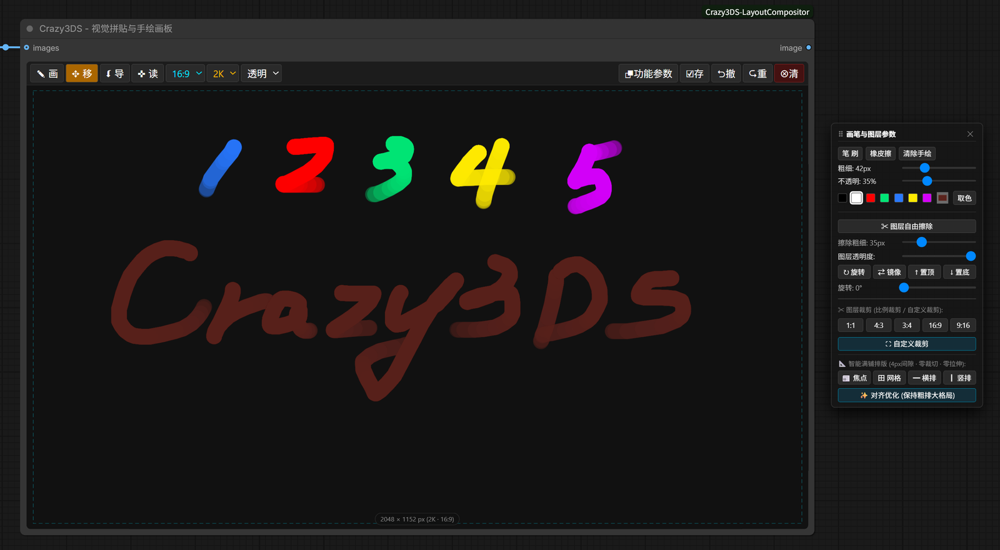
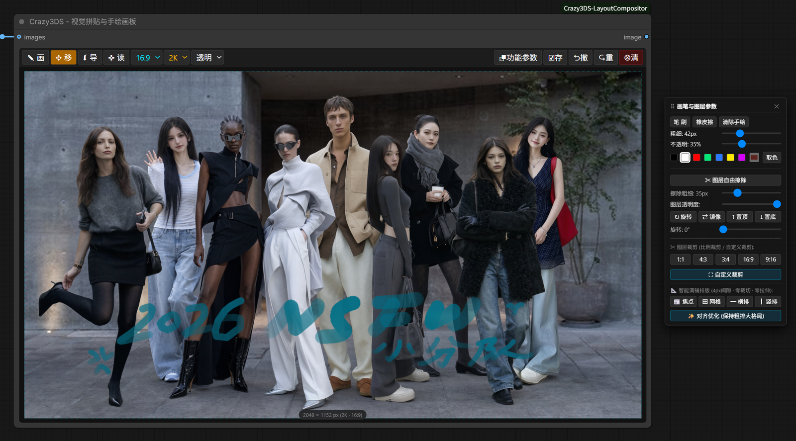
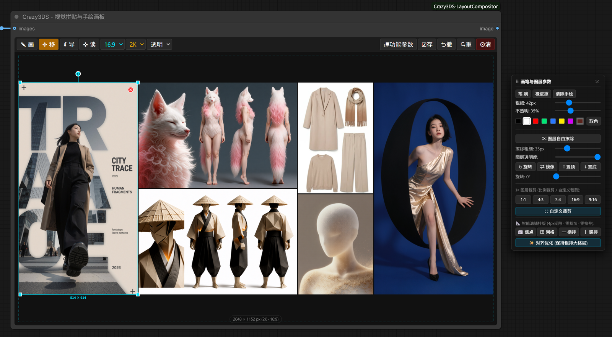

# ComfyUI-Crazy3DS-LayoutCompositor

> **Crazy3DS - 视觉拼贴与手绘画板** ｜ 给图像编辑 / 生成模型用的「前置画板」节点
> 手绘示意 · 区域标记 · 多图导入拼贴 · 读取上游结果宫格自动/手动排版 · 一键存图与传输

一个**独立于采样器的可视化画板节点**：你在节点里把素材摆好、标注好、排版好，节点把这张画板作为 `IMAGE` 直接喂给下游的图像编辑模型（Qwen-Image-Edit / Flux Kontext / GPT-Image-Edit 类工作流 / SDXL inpaint / 任意 img2img 分支）。

📖 **完整使用说明（工作流拆解 / 排版算法 / 数据契约 / 排障）见 [docs/USAGE.md](docs/USAGE.md)**

---

## 界面预览

| 手绘标注 + 参数面板 | 照片上手绘 / 标注 |
|---|---|
|  |  |

| 多图拼贴 + 智能满铺排版（4px 缝隙 / 零裁切 / 零拉伸） |
|---|
|  |

---

## 这是什么

图像编辑类模型（尤其是"带参考图的编辑模型"）最吃的其实是**画板本身**：参考图放哪、占多大、留白多少、要在哪里画圈标注、要拼成几宫格——这些前置工作过去只能在 PS 里做完再导回来。

本节点把这块工作搬进 ComfyUI 画布里：

```
上游出图（1 张 / 一批 / 一个宫格） ──┐
本地素材（拖拽 / Ctrl+V / 导入）   ──┼─▶ 画板（手绘 + 图层 + 裁剪 + 排版） ──▶ IMAGE ──▶ 图像编辑模型
上游连线（images 插槽，多图批量）  ──┘
```

- **零外部依赖**：前端纯 Canvas2D，后端只用 ComfyUI 自带库（torch / numpy / Pillow）。
- **所见即所得**：画板上看到的合成画面 = 下游节点收到的像素，分辨率由你选的档位决定（1K / 2K / 4K / 8K）。
- **自动保存**：节点在工作流里被保存/重开、浏览器刷新后，画板内容会从 `input/crazy3ds_temp` 自动恢复。

---

## 功能分类（8 大类 / 40+ 能力）

### ① 画板规格

| 能力 | 说明 |
|---|---|
| 5 种比例 | `3:4`（768×1024 基准）、`1:1`、`4:3`、`16:9`、`9:16`；切比例时素材**自动居中平移**，不挤压、不变形 |
| 4 档分辨率 | `1K / 2K / 4K / 8K`（倍率 1×/2×/4×/8×，即 2K 的 16:9 就是 2048×1152）；切档位时图层与笔触**同比缩放**，排版关系不丢 |
| 4 种底色 | 白底 / 黑底 / 中灰 / **透明**（透明底导出带 alpha，适合做贴图素材） |
| 尺寸徽标 | 画板底部实时显示 `宽 × 高 px（档位 · 比例）` |

### ② 手绘标注系统（画笔层与图片层分离）

| 能力 | 说明 |
|---|---|
| 画笔 | 圆头笔刷，粗细 `1–150px`，不透明度 `5–100%`，7 色预设 + 原生取色器（任意 HEX） |
| 橡皮擦 | 擦除手绘笔触（`destination-out`，擦完即透明，不会把底图擦白） |
| 吸管取色 | 在画板上直接拾取颜色，取完自动切回画笔 |
| 清除手绘 | 只清笔触，**保留所有图片图层** |
| 分离存储 | 手绘存在独立 `draw` 画布，图片图层在各自画布上 —— 手绘不破坏原图，随时可清除重画 |

> 典型用法：在参考图上圈出"要改的地方"，画箭头、写 `1 2 3 4 5` 分区编号、写目标文字的字形示意。

### ③ 图层系统（图片素材）

| 能力 | 说明 |
|---|---|
| 导入 | ①`⮮ 导` 本地多选；②文件直接**拖进画板**；③`Ctrl+V` 粘贴剪贴板图片；④`✜ 读` 读取上游 |
| 读取上游 | 从 `images` 输入插槽的连线取上游输出：**上游输出多张时逐张载入为独立图层**，并自动阶梯错位（26px/级）避免叠死 |
| 透明自动裁边 | 导入的 PNG 若有全透明边框，载入时自动裁掉（`autoCropTransparentBorders`），拼图不留空边 |
| 选择 | 单击选中；`Shift` 点选增/减多选；空白处拖出**框选**多选；`Alt` 在重叠图层间**穿透下钻**（优先命中非透明像素的图层） |
| 变换 | 拖动移动（多选整体移动）；四角手柄缩放；顶部旋转手柄或滑块旋转 `0–359°`（按住 `Shift` 吸附 15°）；`⇄ 镜像` 水平翻转 |
| 层级 | `↑ 置顶` / `↓ 置底` |
| 透明度 | 单层或多选统一 `0–100%` |
| 图层自由擦除 | ✂ 直接在选中图片上擦像素变透明（不是画白色），擦除粗细 `1–150px`，用于镂空/抠形 |
| 删除 | `Delete` / `Backspace` 删除选中图层（可撤销） |

### ④ 裁剪系统

- 比例裁剪：`1:1 / 4:3 / 3:4 / 16:9 / 9:16` 一键套最大内接框。
- 自定义裁剪：`⛶ 自定义裁剪` 后自由拖框，框内拖动移动、八向手柄缩放、`Shift` 锁比例。
- `Enter` 应用 / `Esc` 取消；裁剪后图层在画面上的**视觉位置与缩放保持不变**（不会"跳"），且可撤销。

### ⑤ 智能满铺排版（核心：4px 缝隙 · 零裁切 · 零拉伸）

自动解算所有素材的**原生宽高比**，用代数求解铺满画板，四边顶死、缝隙严格 4px、绝不拉伸变形：

| 按钮 | 算法 | 适用 |
|---|---|---|
| `📰 焦点` | 主图（当前选中层，否则面积最大层）锁定为视觉核心，副图按列/行分组后**代数求解**最优覆盖率；副图顺序**随机洗牌**，可反复点击探索不同排法；宽画板走"主图+多列"，竖画板走"主图+多行" | 1 张主视觉 + N 张细节图（电商主图、角色三视图） |
| `田 网格` | 按数量预置候选分割方案（3 张：`[2,1] [1,2]`；4 张：`[2,2]`、宽画板 `[4]`、竖画板 `[1,2,1]`；5–8 张各有方案；更多张按 `sqrt(N×比例)` 自适应），逐方案算覆盖率取最优；`N ≤ 2` 自动退化为横排/竖排 | 2×2 / 3×3 宫格、分镜、多角度对比 |
| `━ 横排` | 所有素材**等高**，按原生比例的宽度从左到右排满 | 长卷、流程图、口红色号条 |
| `┃ 竖排` | 所有素材**等宽**，按原生比例的高度从上到下排满 | 竖版长图、穿搭上下装、渐变序列 |
| `✨ 对齐优化` | **保留你的手动粗排大格局**：先按空间拓扑聚类成"纵向分栏"或"横向分行"（用中心距 + Y/X 轴重叠率 >35% 判冲突），再代数拉平列宽/行高、对齐边缘、统一 4px 微缝 | 手动摆了个大概、想让它"变整齐" |

> 排版只改位置和尺寸，不重采样原图 —— 导出时按原图分辨率绘制，画质不因排版损失。

### ⑥ 导出与数据流

| 能力 | 说明 |
|---|---|
| `☑︎存` 存图 | 按**当前档位的最高分辨率**把合成画面导出 PNG 下载（文件名 `crazy3ds_<比例>_<档位>_<时间戳>.png`），透明底保留 alpha |
| 自动回传 | 每次编辑停止 600ms 后自动烘焙并上传到 `input/crazy3ds_temp/node_<节点ID>.png`，`image_name` 指向它 |
| 队列前强制烘焙 | 重写了 `app.queuePrompt`：工作流排队前对所有本节点调用 `forceBakeAndUpload()`，保证下游拿到的是**最新画面**（不是上一次的缓存） |
| 缓存击穿 | 后端 `IS_CHANGED` 用文件的 `mtime + size` 作为指纹，改了画板就一定重跑 |
| `⮿清` 清空 | 清空图层 + 笔触 + 内存池，并调用后端 `POST /crazy3ds/clear_temp` 清理临时 PNG（清空本身也可撤销） |

### ⑦ 撤销 / 重做 / 持久化

- 15 步历史，覆盖：手绘笔触、图层像素擦除、位移/缩放/旋转/镜像/透明度/层级、增删图层、裁剪、自动排版、清空。
- 拖拽类操作**空点不占历史**（按下先暂存，真位移才提交），撤销一次就是你想要的那一步。
- 持久化三件套：`node.properties`（比例/档位/底色/图层几何）、`window._crazy3ds_memory_store`（同会话内存池）、`input/crazy3ds_temp`（PNG 实体）。重开工作流按 `/view` 拉回。

### ⑧ 交互与画布联动

- 顶栏字号随节点宽度自适应（11px→15px），节点拉大不糊。
- 「功能参数」悬浮卡片可拖拽（跟随画布缩放比例），不遮挡画板时可收起。
- 滚轮 / 中键 / `Space + 左键` 全部转发给 ComfyUI 画布，节点内也能缩放平移工作流。
- 右键在画板上 = 退出当前工具（回"移"）或取消图层选中，不会弹浏览器菜单。
- 节点删除时清理 `keydown / pointermove / pointerup / paste / visibilitychange` 监听、`ResizeObserver` 与定时器，多节点 / 反复删建不卡。

---

## 玩法（10 个可直接照抄的用法）

1. **局部重绘圈注**：导入原图 → `✥ 移` 摆满画板 → `✎ 画` 用红圈把要改的区域圈起来 + 写上目标描述 → 输出给 Qwen-Image-Edit / Kontext，prompt 写"按红圈标注的区域修改"。
2. **分区编号编辑**：一张图分 1/2/3/4 区，用画笔在每区写编号 + 目标内容 → prompt 里按编号逐区下指令，一次改多处。
3. **多参考图拼贴**（Character Sheet / 换装）：人物正/侧/背 + 服装单品 + 发型参考 → `田 网格` 或 `📰 焦点` 一键满铺 → 编辑模型按"这些参考图生成一张新图"。
4. **上游结果宫格重排**：上游一次出 4/6/8 张（批次或宫格图）→ `✜ 读` 批量载入为多图层 → `田 网格`/`📰 焦点` 反复点，直到满意 → `☑︎存` 或直接连下游。
5. **线稿 / 火柴人示意**：`✎ 画` 手绘构图骨架（人物位置、镜头框、地平线）→ 作为 ControlNet / 编辑模型的构图输入。
6. **文字排版示意**：用画笔手写目标文字字形与位置（海报标题、产品卖点）→ 让编辑模型按字形重排真实字体。
7. **镂空 / 抠形**：`✂ 图层自由擦除` 在图层上擦出不规则形状（窗口、光圈、剪影）→ 透明底导出当遮罩或素材。
8. **尺寸适配**：同一套排版先切 `1:1` 看方图、再切 `9:16` 看竖屏 —— 素材自动居中，改比例不重排；定稿后切 `4K/8K` 出大图。
9. **批量白底图合成**：多个 SKU 图导入 → `✨ 对齐优化` 或 `━ 横排` 排成商品矩阵 → 透明/白底导出做详情页。
10. **标注对比 / 迭代留痕**：手绘层独立存储，改图不动标注；想重画就 `清除手绘`，想全清就 `⮿清`。

---

## 安装

### 方式 A：ComfyUI Manager
搜索 `ComfyUI-Crazy3DS-LayoutCompositor` 安装（若未收录，用方式 B）。

### 方式 B：手动
```bash
cd ComfyUI/custom_nodes
git clone https://github.com/760689/ComfyUI-Crazy3DS-LayoutCompositor.git
```
或下载 Release 里的 zip，解压到 `ComfyUI/custom_nodes/ComfyUI-Crazy3DS-LayoutCompositor/`，重启 ComfyUI 并**强制刷新浏览器**（`Ctrl+F5`，前端 JS 有缓存）。

目录长这样才算对：

```
ComfyUI/custom_nodes/ComfyUI-Crazy3DS-LayoutCompositor/
├── __init__.py
├── web/crazy3ds_compositor.js
├── docs/*.png
├── README.md
├── CHANGELOG.md
├── LICENSE
└── pyproject.toml
```

### 快速上手（30 秒）
1. 双击画布 → 右键菜单 → `Crazy3DS` → **Crazy3DS - 视觉拼贴与手绘画板**。
2. 把素材拖进画板（或 `Ctrl+V`），或把上游图像节点连到 `images` 插槽后点 `✜ 读`。
3. 点 `田 网格`/`📰 焦点` 排版，`✎ 画` 标注。
4. 节点右侧 `image` 输出连到你的图像编辑模型 → 排队。

---

## 参数说明

### 后端参数（节点本体）

| 参数 | 类型 | 说明 |
|---|---|---|
| `image_name` | STRING | 保存合成图相对 `input/` 的路径（如 `crazy3ds_temp/node_12.png`）。**UI 里被隐藏**，由前端自动维护，不要手填 |
| `images` | IMAGE（可选） | 上游图像输入。画板为空且 `image_name` 无效时，直接透传该张量 |

**输出**：`image`（IMAGE，`[1,H,W,3]`，0–1 float32）。画板完全为空时回退为 1024×1024 白图，避免工作流断链。

### 前端面板参数

| 位置 | 项 | 范围 | 说明 |
|---|---|---|---|
| 顶栏左 | `✎ 画` / `✥ 移` | 工具 | 画笔 / 移动选择（再次点击切换） |
| 顶栏左 | `⮮ 导` | — | 本地导入（可多选） |
| 顶栏左 | `✜ 读` | — | 读取 `images` 插槽的上游输出 |
| 顶栏左 | 比例 | `3:4 1:1 4:3 16:9 9:16` | 切比例自动居中 |
| 顶栏左 | 档位 | `1K 2K 4K 8K` | 切档位等比缩放 |
| 顶栏左 | 底色 | `白底 黑底 中灰 透明` | 导出影响合成底色 |
| 顶栏右 | `⮻功能参数` | — | 展开/收起参数卡（可拖拽） |
| 顶栏右 | `☑︎存` | — | 最高分辨率 PNG 下载 |
| 顶栏右 | `⮌撤` / `⮎重` | 15 步 | 撤销 / 重做 |
| 顶栏右 | `⮿清` | — | 清空画布 + 临时缓存 |
| 参数卡 | 笔刷 / 橡皮擦 / 清除手绘 | — | 手绘模式切换 |
| 参数卡 | 粗细 | 1–150px | 画笔与橡皮共用 |
| 参数卡 | 不透明 | 5–100% | 画笔不透明度 |
| 参数卡 | 色板 / 取色 / 吸管 | 7 色 + HEX | 画笔颜色 |
| 参数卡 | 图层自由擦除 + 擦除粗细 | 1–150px | 在图片图层上擦成透明 |
| 参数卡 | 图层透明度 | 0–100% | 支持多选统一设置 |
| 参数卡 | 旋转 / 镜像 / 置顶 / 置底 | 0–359° | 旋转滑块按住 `Shift` 吸附 15° |
| 参数卡 | 比例裁剪 / 自定义裁剪 | — | `Enter` 应用、`Esc` 取消 |
| 参数卡 | 智能满铺排版 | 焦点/网格/横排/竖排/对齐优化 | 见上文章法说明 |

### 快捷键与鼠标

| 操作 | 效果 |
|---|---|
| `Ctrl + Z` | 撤销 |
| `Ctrl + Shift + Z` / `Ctrl + Y` | 重做 |
| `Delete` / `Backspace` | 删除选中图层（"移"模式下） |
| `Enter` | 应用裁剪 |
| `Esc` | 取消裁剪 |
| `Shift + 点击` | 多选增/减 |
| `Alt + 点击` | 重叠图层穿透下钻 |
| 空白处拖拽 | 框选多个图层 |
| `Ctrl + V` | 粘贴剪贴板图片为新图层（悬停或选中节点时） |
| 拖文件进画板 | 批量导入图片 |
| 右键画板 | 退出当前工具 / 取消选中 |
| 滚轮 / 中键 / `Space + 左键` | 缩放平移工作流画布 |

---

## 技术说明（数据流）

```
前端 Canvas 编辑
   ├─ drawCanvas  : 手绘层（透明）
   ├─ layers[i]   : 每个素材一个独立 canvas（原图分辨率）
   └─ exportCanvas: 合成导出层（targetW × targetH）
        │ debouncedSave 600ms / queuePrompt 前 forceBakeAndUpload
        ▼
POST /upload/image  →  input/crazy3ds_temp/node_<id>.png   （合成图）
                    →  input/crazy3ds_temp/draw_<id>.png    （手绘层，有改动才传）
                    →  input/crazy3ds_temp/layer_<id>.png   （素材层，有改动才传）
        ▼
节点 widget image_name = "crazy3ds_temp/node_<id>.png"
        ▼
POST execute(): 读文件 → EXIF 纠正 → RGBA 合成到白底 → RGB → numpy/255 → torch[1,H,W,3]
        ▼
下游 IMAGE
```

- `IS_CHANGED` = `mtime_size`，画板一变就重算；`POST /crazy3ds/clear_temp` 由 `⮿清` 触发，用于回收 `input/crazy3ds_temp`。
- 逐层增量上传：只移动图层不会重传笔触层，只裁一层不会重传其它层（`_needsUpload` / `drawLayerDirty` 标记）。
- 大档位（4K/8K）的 PNG 烘焙延后到操作停止 600ms 后，避免连续拖动时鼠标卡顿。

---

## 适用工作流

| 工作流 | 适配方式 |
|---|---|
| **文生图（txt2img）** | 画板当"构图/文字示意板"：手绘骨架 + 手写文字 → 输出接 ControlNet / 图像提示（IP-Adapter）或直接当 img2img 起点。也可用 `☑︎存` 只取图做素材 |
| **图生图（img2img）** | 画板当"参考底板"：原图铺满 + 标注圈选 → 输出接 img2img，`denoise` 控制改动幅度 |
| **图像编辑模型**（Qwen-Image-Edit / Flux Kontext / GPT-Image-Edit 类） | 主用法：拼贴多参考图 + 区域标注 + 分区编号，一次给足上下文 |
| **局部重绘 / inpaint** | 图层自由擦除挖洞 + 手绘遮罩示意 → 输出接 inpaint 分支（或用 `⮿清` 后的透明底做 mask 素材） |
| **批量素材整理**（非生成） | 上游批量出图 → `✜ 读` → `田 网格` → `☑︎存`，纯排版不跑模型 |

---

## 常见问题

**Q：点 `✜ 读` 提示"上游节点尚未运行"？**
先跑一次上游让 ComfyUI 产生 `nodeOutputs`，再点读取。要读多张，请让上游输出为批次/多图。

**Q：改了画板，下游出的图没变？**
本节点在 `queuePrompt` 前会强制烘焙，一般不会。若仍异常：确认 `image_name` 未被手动改成别的文件，或点一次 `☑︎存` 检查画面是否正确。

**Q：8K 卡顿？**
8K 合成一次约 3000 万像素，PNG 编码耗时明显。建议编辑时用 2K，定稿再切 4K/8K。

**Q：`input/crazy3ds_temp` 越来越大？**
每次 `⮿清` 会清理该目录；也可手动删除（不影响已保存的工作流，重开画板会重新生成）。

**Q：刷新浏览器后画板空了一会儿？**
需从 `/view` 拉回 PNG（大档位稍慢），加载完成会自动重绘；`properties` 里的几何信息同时恢复。

---

## 目录结构

```
├── __init__.py                      # 节点类 + /crazy3ds/clear_temp 路由 + 映射表
├── web/crazy3ds_compositor.js       # 全部前端逻辑（画板 / 图层 / 裁剪 / 排版 / 上传）
├── docs/                            # 截图 + 完整使用说明 USAGE.md
├── README.md / CHANGELOG.md / LICENSE / pyproject.toml / .gitignore
```

## 版本

见 [CHANGELOG.md](CHANGELOG.md)。当前 `v1.0.0`。

## License

MIT © Crazy3DS

---

## English (short)

**ComfyUI-Crazy3DS-LayoutCompositor** — a visual layout/prep board node for image-editing models.

Draw annotations, mark regions, import & collage multiple images, pull upstream results into the board and auto-layout them as grids, then export or feed the composite `IMAGE` downstream.

Highlights: 5 aspect ratios × 4 resolution tiers (1K–8K) × 4 backgrounds; brush / eraser / eyedropper with an isolated drawing layer; multi-layer transform (move, scale, rotate, mirror, opacity, z-order, pixel-erase); ratio & freeform crop; five deterministic full-bleed auto-layout algorithms (hero / grid / row / column / tidy) with strict 4px gutters, zero crop, zero stretch; 15-step undo/redo; PNG export at full board resolution; auto-persist to `input/crazy3ds_temp` with forced bake before queueing so downstream always gets the latest board.

Works for txt2img (composition board), img2img (annotated reference), image-edit models (multi-reference collage + region marks) and inpaint (erase-through holes).
